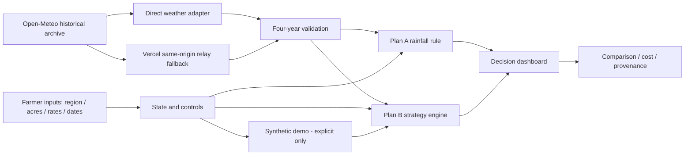

# SeedHedge v0.4.1 — Decision Dashboard Stabilization & Release Packet

## Scope

Replaces only the old two-card comparison section with a component-based dashboard. Existing strategy engine, rainfall/temperature heuristics, region dropdown, weather retrieval, local cost edits, virtual farm editor, forecast context, voice summary, and routes remain preserved.

- Farmer overview: region, acres, supported soybean Kharif crop, enabled candidate date count.
- Evidence state: historical loading/verified/error versus explicitly synthetic demo. No substituted observations.
- Plan A: editable 14-day rainfall cutoff, independent all-years historical rule, per-date/year rainfall matrix and outcome classification.
- Plan B: strategy count, modeled accepted count, minimum-cost acceptable result, and allocation strip.
- Trade-off: separate messages for both qualified, only A, only B, neither, and missing evidence.
- Shared cost decomposition and visit surcharge.
- Expandable equations, replay-year threshold sensitivity and a live source link.
- Mobile responsive card and table layout with semantic text/labels.

## Data provenance and validation scope

Historical Open-Meteo ERA5 reanalysis for 2022–2025 is real retrospective weather evidence; it is not the forecast farmers would have seen at sowing time. Open-Meteo's service is not a government-issued Indian weather feed. Do not claim official IMD sourcing. Historical coverage is all-or-none; if any of four years fails, the historical result is unavailable. There is a same-origin Vercel relay fallback already present in v0.4. A ready state means the existing weather adapter accepted the responses, not that the heuristic is agronomically validated.

The Plan A all-years threshold rule and Plan B exposure formula/cutoff are **experimental**. Neither proves real crop-loss reduction or sowing safety. Synthetic demo must be explicitly activated.

## Architecture

## Release gates

1. `npm test`: all tests pass, including rainfall threshold and weather transport tests.
2. `npm run build`: full TypeScript/Vite build passes.
3. Playwright Chromium smoke: old controls + new dashboard, real historical test mocked only for deterministic UI checks, synthetic indicators and mobile screenshots.
4. Preview: inspect actual Open-Meteo requests for Akola, Jalna, Nagpur and Pune, response units, 2022–2025 integrity and fallback, desktop/mobile, no console errors.
5. Exact preview commit verified, separate merge authorization, production deploy, recheck real historical response on public URL.

**No release is certified merely because the source bundle is created.**

## Windows install

Root: `C:\Users\Chaitany\OneDrive\Pictures\Downloads\SeedHedge-starter-v0.1\SeedHedge`

Place changed `src/` files, `tests/` and `docs/` from the ZIP at that root. Confirm repository is on `main` and clean before creating feature branch `feat/v041-decision-dashboard`. Run `npm test`, then `npm run build`, then `npm run dev` and verify. Commit changed files only, push new branch and create a PR. Keep production unchanged until certified.
