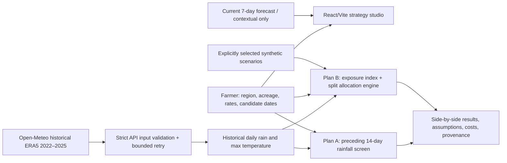

# SeedHedge v0.4 — Two prototype approaches to climate-aware soybean sowing

## Scope
A single-screen strategy studio for soybean Kharif in Akola, Jalna, Nagpur and Pune. The dataset is **historical Open-Meteo ERA5 reanalysis 2022–2025** for 1 June–10 July in each year. Candidate dates refer to **2024** for the historical counterfactual. Current seven-day forecasts are displayed as contextual information **but never fed into these 2024 decisions**. Neither approach is validated agronomic advice.

## Architecture

## One complete demonstration case
- **Farmer:** Akola, 2 acres; soybean Kharif.
- **Question:** For a set of June/July candidate dates, how would a simple rainfall-timing rule compare to a strategy that splits sowing across dates?
- **Plan A:** Pick earliest enabled date with preceding-14-day rain ≥ user-selected threshold in **every** 2022–2025 replay year. This conservative all-years criterion is a *prototype choice*. If none qualifies, report none. No subsequent rain is used to decide the date.
- **Plan B:** Enumerate single- and two-date 10%-increment allocations (95 at five candidate dates). For each historical year score each date via a dimensionless heuristic; weighted split exposure must pass the 0.60 threshold in every replay year. Rank passing options by same cost assumptions.
- **What to change live:** Rainfall rule threshold 100→50 mm; split allocation 50/50→70/30; mobilization ₹450→₹2000; Stress→Stable in **synthetic mode**. Some outcomes may remain unchanged, which is meaningful and should be explained.
- **Conclusion:** Compare qualification under each rule, total cost and extra visits. Do not declare any option crop-safe or imply measured crop-loss reduction.

## Scientific formula and provenance
Plan A: `preceding14 = sum(precipitation_sum over days -14 to -1)`. Rule: preceding14 ≥ adjustable threshold for each historical year. Default 100 mm is a *starting assumption informed by* an ICAR-NSRI soybean advisory about monsoon onset and rainfall, **not** validation of this specific 14-day/all-years algorithm.

Plan B per-date index: `shortfall = max(0,(100 - preceding14)/100)`; `excess = max(0,(next3dayRain - 85)/85)`; `heat = max(0,(maxTempNext3Days - 36)/10)`; `index = min(1, .68*shortfall + .20*excess + .12*heat)`. Split index is area-share-weighted; the worst year must be ≤ 0.60. The 85-mm, 36°C, weights, and 0.60 cutoff are **unvalidated prototype heuristics**, not crop-loss probabilities or certified thresholds. Unlike Plan A, Plan B includes *post-sowing observations* during historical hindsight replay; do not imply these were known on the 2024 decision date.

Data provider: [Open-Meteo Historical Weather API](https://open-meteo.com/en/docs/historical-weather-api), `archive-api.open-meteo.com/v1/archive`, explicit `models=era5`; request URLs accessible from the UI. ERA5 is reanalysis, not field measurement. A full outcome-based evaluation requires independently observed crop establishment/yield, expert guidance, alternative baselines, geospatial resolution assessment and temporal holdout design.

## Economic comparison
For BOTH plans, `cost = acres × (seed kg/acre × ₹/kg + labour ₹/acre + machinery ₹/acre) + planting visits × (mobilisation ₹/visit + other ₹/visit)`. Rates are editable **example values**, not verified market rates. The additional visit cost is exactly `mobilisation + other`. Plan A is one visit; Plan B may be one or two.

## Data states / failure boundaries
- **Loading:** App shows loading, not final recommendation.
- **Ready:** All four archive years must pass strict length, units, timezone and numeric checks before historical scenarios become available.
- **Failure:** Which years and why are shown. Retry attempts are bounded; no partial real data is represented as complete. The user may explicitly choose synthetic demo.
- **Synthetic:** Stress and Stable use fabricated scenario inputs; Plan A is marked unavailable, not silently computed from synthetic data.

## Release gates
Run `npm test`, `npm run build`, and GitHub Chromium QA on the exact PR head; then test Vercel preview on desktop/mobile with **actual unmocked** Open-Meteo responses and browser network errors recorded. Only merge after PASS and deliberate release approval. No production changes are authorized by this packet.

## Evidence limitations
Passing Chromium tests uses deterministic mocked API data; that verifies interface response and safe failure behavior, not the real API's availability at judges' location. The supplied isolated live diagnostic can be run as `node scripts/check-live-weather.mjs akola` from a network-enabled machine; it cannot replace a real deployed-browser check.

## Vercel weather relay fallback
`api/historical.ts` provides a restricted GET `/api/historical?region=akola&year=2024` endpoint, accepting **only four predefined regions and replay years 2022–2025**. When a browser call fails due to network errors, HTTP 429 or upstream 5xx, the frontend tries this same-origin relay. It still uses Open-Meteo ERA5, not synthetic values. Invalid upstream payloads are rejected by the existing strict client validation. The relay is intended to mitigate browser-side access problems, but availability depends on Vercel runtime/network and upstream capacity; it is **not verified in production**. Verify `/api/historical?region=akola&year=2024` returns JSON in the Vercel preview before release.
